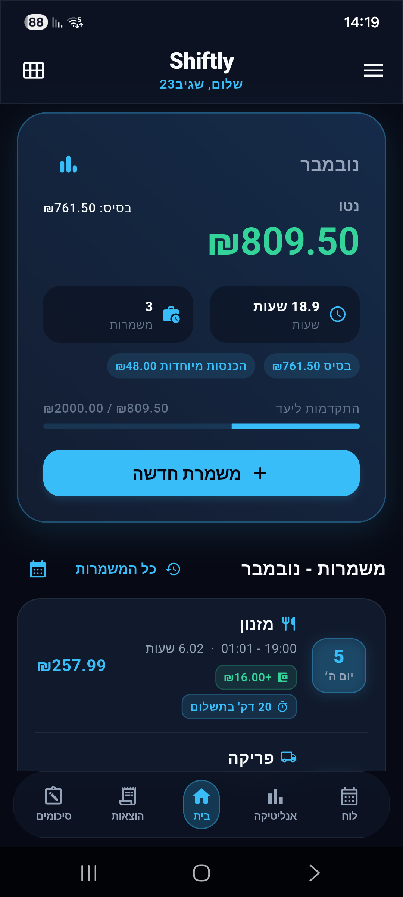
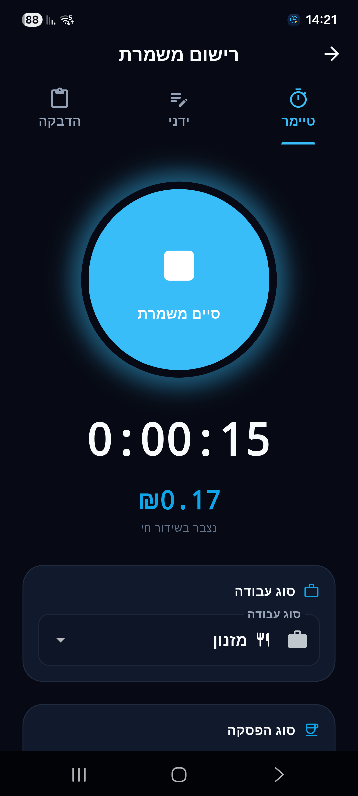
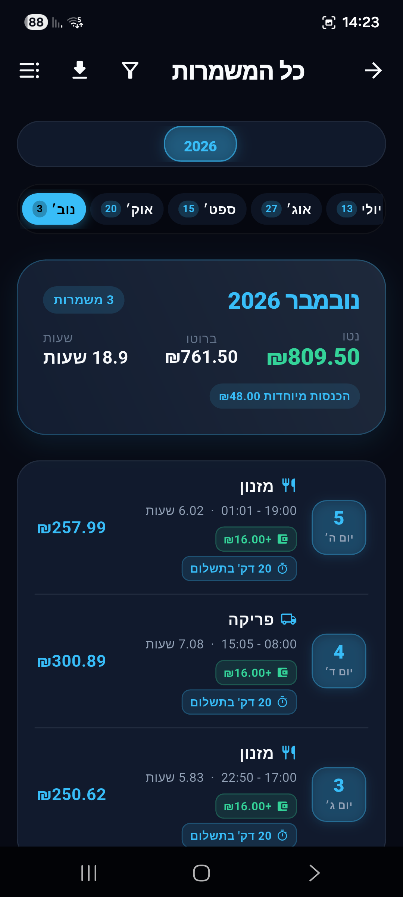
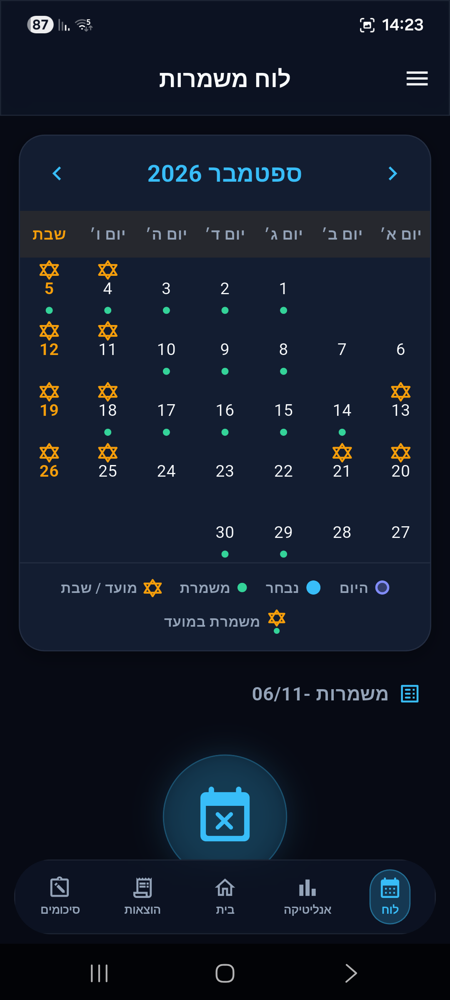
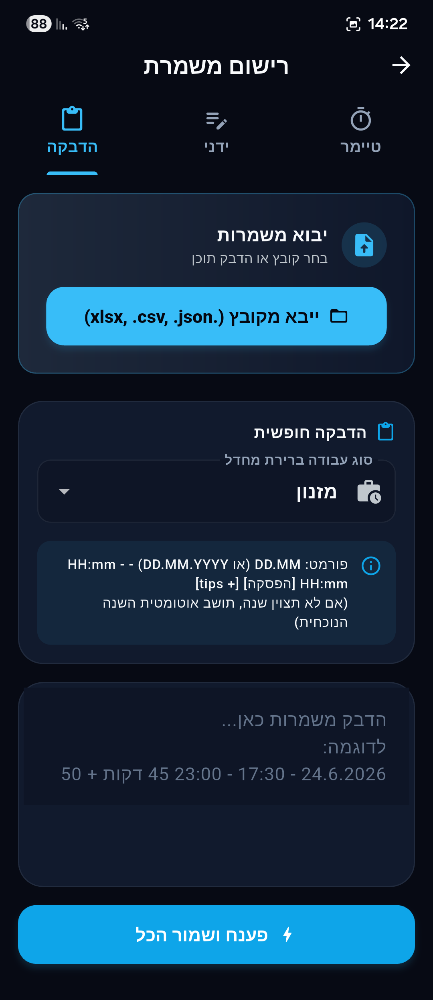
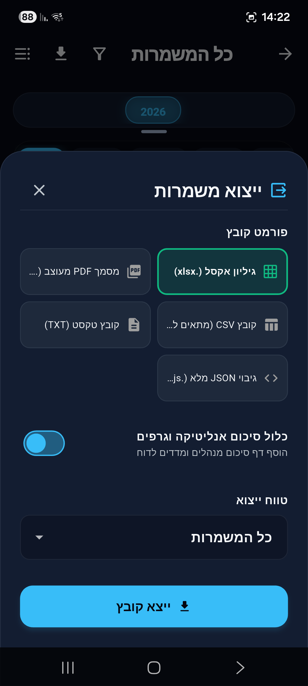
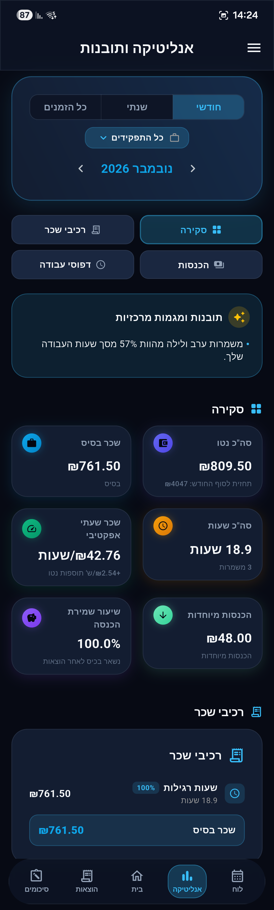
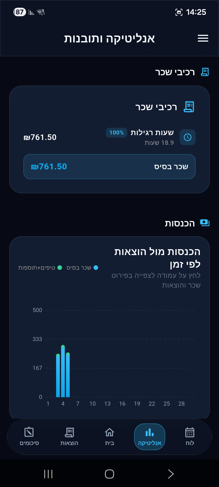
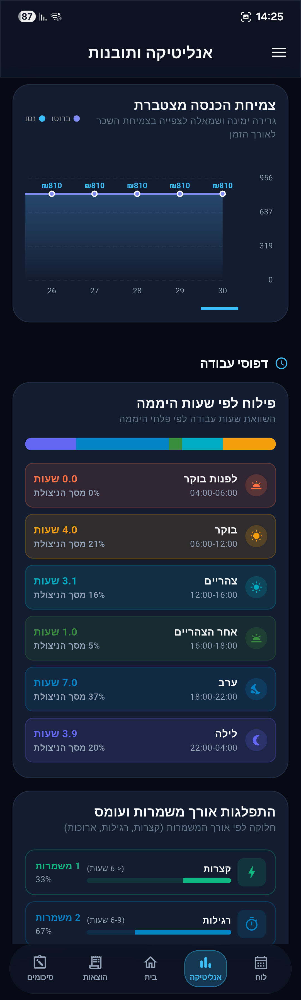
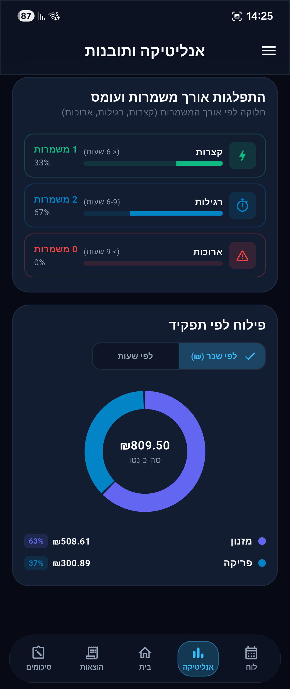

# Shiftly

אפליקציית ניהול משמרות, שכר והוצאות חוצת-פלטפורמות (Flutter) המותאמת למודל העבודה בישראל.

<p style="text-align: center;">
  <a href="https://shiftly-ujfd.onrender.com/" target="_blank"></a>
  <a href="https://github.com/Sagiv23/ShiftlyApp/releases/tag/v1.1.4" target="_blank"></a>
  <a href="PRIVACY.md"></a>
  <a href="TERMS.md"></a>
  
</p>

---

## תוכן עניינים | Table of Contents

1. [סקירה טכנית | Technical Overview](#סקירה-טכנית--technical-overview)
2. [תכונות ליבה | Core Features](#תכונות-ליבה--core-features)
3. [מסמכים משפטיים | Legal Documents](#מסמכים-משפטיים--legal-documents)
4. [ארכיטקטורה וזרימת נתונים | Architecture & Data Flow](#ארכיטקטורה-וזרימת-נתונים--architecture--data-flow)
5. [ערכת עיצוב | Design Tokens](#ערכת-עיצוב--design-tokens)
6. [תמונות מסך | Screenshots](#תמונות-מסך--screenshots)
7. [הוראות פיתוח ובניית גרסאות | Development & Build Guide](#הוראות-פיתוח-ובניית-גרסאות--development--build-guide)

---

## סקירה טכנית | Technical Overview

Shiftly נבנתה בארכיטקטורת **Offline-First**, בה כל הנתונים נשמרים מקומית במסד נתונים **Hive (NoSQL)
** ומוצפנים באמצעות **Flutter Secure Storage**. המערכת כוללת אפשרות לסנכרון מול שרת ענן חיצוני,
ומנגנון לגיבוי עצמי (BYOS) מול Google Drive (`appDataFolder`).

---

## תכונות ליבה | Core Features

* **שעון נוכחות וטיימר:** מעקב זמן אמת אחר משמרות, כולל ניהול הפסקות (בתשלום / ללא תשלום) ושליטה
  מווילון ההתראות במכשיר.
* **חישוב שעות נוספות:** מנוע חישוב יומי ושבועי המבוסס על מדרגות תעריף מוגדרות (לדוגמה: 125%, 150%).
* **זיהוי שבתות וחגים:** זיהוי זמני כניסת ויציאת שבת וחגים בהתאם ללוח העברי ולמיקום גיאוגרפי, לשם
  תחבולת שכר מותאמת (150%, 200%).
* **מנוע פיענוח טקסט חופשי (Smart Parser):** קליטת משמרות מרובות באמצעות הדבקת טקסט חופשי בפורמט
  הבא:
  ```text
  24.06.2026 - 17:30 - 23:00 45 דקות + 50
  ```
* **ניהול היסטוריית שכר (Wage Rates):** מעקב אחר שינויים בשכר השעתי לפי תאריכי תחולה, כך שעדכון שכר
  אינו משפיע בדיעבד על משמרות קודמות.
* **ניהול הוצאות וטיפים:** רישום טיפים, הוצאות נלוות (נסיעות/אוכל), והגדרת הוצאות קבועות.
* **אבטחת סשן ושימור נתונים:** ניתוק בטוח של משתמשים שחשבונם פג או הוסר (Unauthorized/Deleted
  Session) **בלי למחוק את הנתונים המקומיים**, בצירוף התראה מותאמת.
* **ייצוא דוחות:** הפקת דוחות סיכום נתונים בקבצי **PDF, CSV ו-Excel**.

---

## מסמכים משפטיים | Legal Documents

השימוש באפליקציה כפוף למדיניות הפרטיות ותנאי השימוש המפורטים במסמכי הפרויקט:

| מסמך                                |        קובץ מקומי        |                       קישור רשת ציבורי                        |
|:------------------------------------|:------------------------:|:-------------------------------------------------------------:|
| **מדיניות פרטיות (Privacy Policy)** | [PRIVACY.md](PRIVACY.md) | [תצוגת אינטרנט](https://sagiv23.github.io/ShiftlyApp/privacy) |
| **תנאי שימוש (Terms of Service)**   |   [TERMS.md](TERMS.md)   |  [תצוגת אינטרנט](https://sagiv23.github.io/ShiftlyApp/terms)  |

> ⚠️ *הערה משפטית:* חישובי השכר באפליקציה מיועדים להתרשמות ובקרה אישית בלבד, ואינם מחליפים תלוש שכר
> רשמי המונפק על ידי המעסיק (ראו פירוט ב-[TERMS.md](TERMS.md)).

---

## ארכיטקטורה וזרימת נתונים | Architecture & Data Flow

```
                                  ┌───────────────────────────┐
                                  │   Flutter Client App      │
                                  │ (Android, iOS, Web, Desk) │
                                  └─────────────┬─────────────┘
                                                │
                      ┌─────────────────────────┼─────────────────────────┐
                      │                         │                         │
                      ▼                         ▼                         ▼
            ┌───────────────────┐     ┌───────────────────┐     ┌───────────────────┐
            │ Local Hive NoSQL  │     │ Node.js + PG API  │     │ Google Drive API  │
            │  (Offline-First)  │     │  (Shiftly Cloud)  │     │  (BYOS Backups)   │
            └───────────────────┘     └───────────────────┘     └───────────────────┘
```

---

## ערכת עיצוב | Design Tokens

האפליקציה ממומשת לפי תקן **Material 3** ותומכת במצב כהה (Dark Mode):

| אלמנט עיצובי          |  ערך Hex  | שימוש עיקרי                |
|:----------------------|:---------:|:---------------------------|
| **Primary Sky Blue**  | `#38BDF8` | צבע מותג ראשי והדגשות      |
| **Primary Dark**      | `#0EA5E9` | כפתורי פעולה משניים        |
| **Dark Background**   | `#0F172A` | רקע כללי (Slate 900)       |
| **Dark Container**    | `#1E293B` | כרטיסים ומכלים (Slate 800) |
| **Profit / Income**   | `#22C55E` | הכנסות וסיכומים חיוביים    |
| **Expense / Warning** | `#F87171` | הוצאות והתראות             |

---

## תמונות מסך | Screenshots

|                       מסך הבית (Home)                        |                      טיימר משמרת (Timer)                      |                      כל המשמרות (All Shifts)                       |
|:------------------------------------------------------------:|:-------------------------------------------------------------:|:------------------------------------------------------------------:|
|  |  |  |

|                     תצוגת לוח שנה (Calendar)                     |               פיענוח טקסט חופשי (Smart Parser)                |                      ייצוא דוחות (Export)                      |
|:----------------------------------------------------------------:|:-------------------------------------------------------------:|:--------------------------------------------------------------:|
|  |  |  |

### ניתוחים וסטטיסטיקות (Analytics Suite)

|                                                                    |                                                                    |                                                                    |                                                                    |
|:------------------------------------------------------------------:|:------------------------------------------------------------------:|:------------------------------------------------------------------:|:------------------------------------------------------------------:|
|  |  |  |  |

---

## הוראות פיתוח ובניית גרסאות | Development & Build Guide

### 1. הרצה מקומית
```bash
# התקנת תלויות
flutter pub get

# יצירת מודלי Hive Adapters
dart run build_runner build --delete-conflicting-outputs

# הרצת האפליקציה
flutter run
```

### 2. בניית גרסאות Release
* **Android APK:**
  ```bash
  flutter build apk --split-per-abi --release --obfuscate --split-debug-info=build/app/outputs/symbols
  ```
  *הערה:* עדכונים דורשים שמירה על אותו `applicationId` ומפתח חתימה. יש להגדיר ב-GitHub Actions את
  הסודות: `ANDROID_KEYSTORE_BASE64`, `ANDROID_KEYSTORE_PASSWORD`, `ANDROID_KEY_ALIAS`, ו-
  `ANDROID_KEY_PASSWORD`.

* **iOS IPA:**
  ```bash
  flutter build ipa --release --obfuscate --split-debug-info=build/app/outputs/symbols
  ```
  *הערה:* קובץ ה-IPA נבנה ללא חתימה ודורש חתימת Apple והפצה מוגדרת מראש להתקנה במכשירים אמיתיים.
